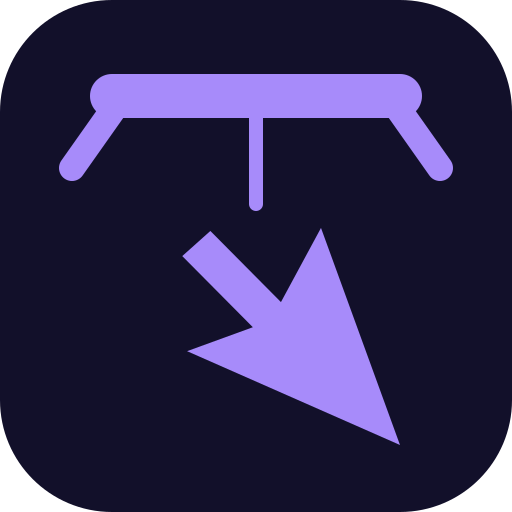

<p align="center">
  
</p>
<h1 align="center">puppet</h1>
<p align="center"><strong>Give your coding agent eyes and hands for your Windows desktop.</strong></p>

A native-Rust MCP server over stdio that screenshots, lists and drives Windows windows — background-safe by default, so your agent works without stealing your focus, your pointer or your keyboard.

## Install

Add the server to your OpenCode config — `~/.config/opencode/opencode.jsonc` for every project, or `./opencode.jsonc` for this one — and save; OpenCode reloads config on save, no restart:

```jsonc
{
  "$schema": "https://opencode.ai/config.json",
  "mcp": {
    "servers": {
      "puppet": {
        "type": "local",
        "command": ["cmd", "/c", "npx", "-y", "puppet-mcp@latest"]
      }
    }
  }
}
```

Then confirm the launcher and its pin — prints the manifest and the resolved engine cache path, downloads and provisions nothing:

```powershell
npx -y puppet-mcp@latest --doctor
```

The first real call provisions the pinned server binary from the tagged GitHub Release, sha256-verified before and after extraction.

## What you get

| Tool | What it does for you |
|---|---|
| `screenshot` | Captures the whole desktop, one monitor, a region, or one window — without activating it — and returns the image plus the map that turns image pixels back into screen pixels. |
| `list_windows` | Read-only list of every visible top-level window with `hwnd`, `pid`, `exe`, `title`, rects, DPI and whether it runs elevated: the starting point for any selector. |
| `window` | Focus, move, resize, minimize, maximize, restore, close or topmost a window by selector; every verb except an explicit `focus` is no-steal. |
| `do` | Runs an ordered batch of input actions — click, drag, scroll, type, keys, waits, UIA `invoke`/`set_value`, clipboard — against one locked target in a single round-trip. |
| `cursor` | Read-only cursor position plus monitor rectangles. |
| `elements` | Read-only structured UIA control tree for a window, with stable `ref`/`fp` identities and paging, so the agent acts on named controls instead of guessing pixels. |

Every acting call takes one `target` selector and locks exactly one window; there is no fallback to the foreground window, ever.

## Requirements

Windows 10/11 x64 with Node 22.14 or newer — the server runs at your own integrity level, so input aimed at an elevated window is refused with a typed error rather than failing silently, and nothing takes focus, raises a window or moves your pointer unless a call explicitly passes `allow_foreground` / `allow_cursor`.

## Going deeper

The manual — provisioning model, every option and environment variable, every tool and argument, the `do` burst, troubleshooting and limitations: [docs/GUIDE.md](docs/GUIDE.md).

<!-- nathwn12 house footer: identical in every repo. Do not edit. -->
<p align="center">
  <a href="https://github.com/nathwn12"></a>
</p>
<p align="center">
  <sub>Built by <a href="https://github.com/nathwn12">nathwn12</a> · <a href="https://github.com/nathwn12?tab=repositories">All projects</a></sub>
</p>
