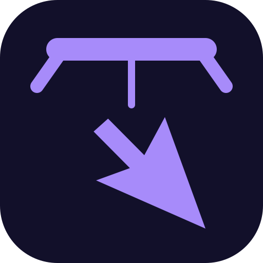

<p align="center">
  
</p>
<h1 align="center">puppet</h1>
<p align="center"><strong>Screenshot, list, and drive Windows windows over MCP stdio without stealing focus, moving the pointer, or writing the clipboard.</strong></p>

## Install

Add the server to your MCP client. OpenCode reloads the config on save, so no restart:

```jsonc
{
  "$schema": "https://opencode.ai/config.json",
  "mcp": {
    "servers": {
      "puppet": {
        "type": "local",
        "command": ["cmd", "/c", "npx", "-y", "puppet-mcp@latest"]
      }
    }
  }
}
```

The client runs `npx -y puppet-mcp@latest` and speaks MCP over stdio, so that process is spawned by the client, not typed in a terminal. Your first real call provisions the pinned server binary from the tagged GitHub Release, sha256-verified before and after extraction. A global install is refused by the package's install scripts.

Confirm the launcher and its pin first: `npx -y puppet-mcp@latest --doctor` prints the launcher version, the pinned manifest, the resolved engine path and whether the versions match. It performs no fetch and exits 0.

### Or let your AI install it

```text
Install nathwn12/puppet (puppet-mcp) as a local stdio MCP server with npx -y puppet-mcp@latest, then prove it works.
1. Run: npx -y puppet-mcp@latest
2. First run: the client spawns that command, which provisions the pinned server binary from the tagged GitHub Release (sha256-verified); it needs Windows x64 and Node 22.14 or newer.
3. Done when: npx -y puppet-mcp@latest --doctor exits 0 and prints "versionsMatch": true.
If it fails, stop and paste the full output; do not improvise a fix.
```

## Use it

Ask the agent to list the visible windows: one entry per window with `hwnd`, `pid`, `exe`, `title` and screen-space rects.

- `screenshot` captures the whole virtual desktop, one monitor, a window or a region, without activating it.
- `diff` compares two captures pixel by pixel and returns the changed count and ratio, a bounding box and an optional diff image.
- `list_windows` reads the visible top-level windows; it never changes focus.
- `window` moves, resizes, minimizes, restores, closes or pins a window to the top. Focus and maximize are refused.
- `do` runs an ordered burst of actions against one locked target: UIA patterns first, then window messages.
- `cursor` reports the pointer position and the monitor rects.
- `elements` returns structured UI elements with a stable ref and fingerprint.

That is seven tools. The server runs at its own integrity level: input aimed at an elevated window is refused with `uipi_blocked` instead of failing silently, and a minimized window is `window_minimized` rather than restored behind your back.

Every argument, default and typed error: [docs/GUIDE.md](docs/GUIDE.md).

## Configure it

No flag serves MCP over stdio. The launcher also takes `--doctor`, `--print-manifest`, `--version` and `--help`.

| Variable | Default | Effect |
|---|---|---|
| `PUPPET_ENGINE_CACHE` | the engine's own leaf under the per-user cache | Absolute cache directory for the pinned binary. |
| `PUPPET_UIA_TIMEOUT_MS` | `5000` | Deadline for one bounded UIA operation, clamped to 50..120000. |
| `PUPPET_CAPTURE_TIMEOUT_MS` | `10000` | Deadline for one `PrintWindow` capture, clamped to 50..120000. |

Raise the UIA deadline for a slow target. Add this to the `puppet` entry from Install:

```jsonc
"environment": { "PUPPET_UIA_TIMEOUT_MS": "15000" }
```

## Requirements

- Windows 10/11 x64. The server runtime runs on no other platform.
- Node 22.14 or newer, for the `npx` launcher.
- An MCP client that speaks stdio.
- The first run downloads the pinned server binary and verifies its sha256 twice. It installs nothing system-wide.
- The server cannot drive an elevated window, reach a UAC prompt, or restore a minimized one; each is a typed error.

## Development

```sh
cargo check --locked
cargo test --locked
```

The toolchain is pinned by `rust-toolchain.toml`. `cargo fmt --all --check` and `cargo clippy --all-targets --locked -- -D warnings` are the static gate. `PUPPET_LIVE_DESKTOP=1` enables the live-gated tests, which skip cleanly without it. The `do` burst is in [docs/GUIDE.md](docs/GUIDE.md), the hidden-desktop mode in [docs/HEADLESS.md](docs/HEADLESS.md), and the release lane in [docs/PUBLISHING.md](docs/PUBLISHING.md).

CI runs `fmt`, `clippy`, `gitleaks`, `cargo check` and the single conformance binary. A change that only touches Markdown, `docs/` or `LICEN[CS]E` skips everything but `gitleaks`, because a secret pasted into documentation is still a secret.

## Status

**Active** — maintained, issues welcome.

## Links

- [Issues](https://github.com/nathwn12/puppet/issues)
- [Releases](https://github.com/nathwn12/puppet/releases)
- [Guide](docs/GUIDE.md)
- [Headless desktop](docs/HEADLESS.md)
- [Publishing](docs/PUBLISHING.md)
- [Third-party notices](THIRD-PARTY-NOTICES.md)
- [MIT](LICENSE)
